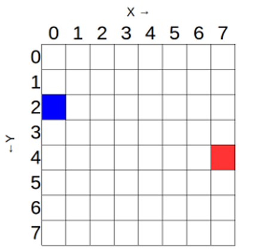

The Sense HAT's LED matrix uses a coordinate system with an x- and a y-axis. The numbering of both axes begins at `0` (not 1) in the top left-hand corner. Each LED can be used as one pixel of an image, and it can be addressed using an `x, y` notation.



The blue pixel is at coordinates `0, 2`.
The red pixel is at coordinates `7, 4`.

You can set pixels (LEDs) individually using the `set_pixel()` method.

To replicate the diagram above, you would enter a program like this:

```python
from sense_hat import SenseHat
sense = SenseHat()

blue = (0, 0, 255)
red = (255, 0, 0)

sense.set_pixel(0, 2, blue)
sense.set_pixel(7, 4, red)
```

<iframe src="https://editor.raspberrypi.org/en/embed/viewer/rpi-sensehat-led-coordinates-example" width="100%" height="600" frameborder="0" marginwidth="0" marginheight="0" allowfullscreen></iframe>

The Code Editor shows the Sense HAT on its side, so the picture is turned a quarter-turn clockwise. If you see a white smiley face, click **Run** again.

[Open this code in the Code Editor](https://editor.raspberrypi.org/en/projects/rpi-sensehat-led-coordinates-example){:target="_blank"}
